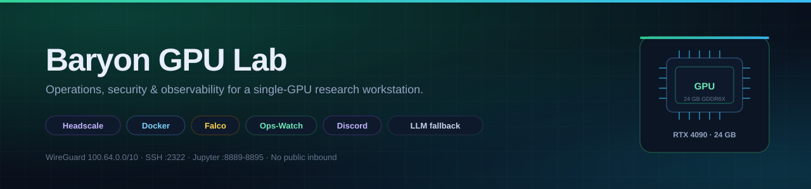
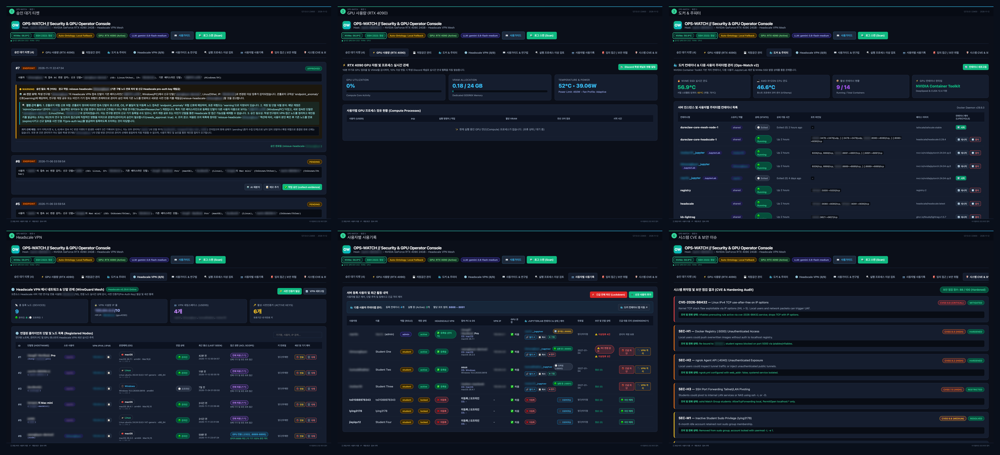
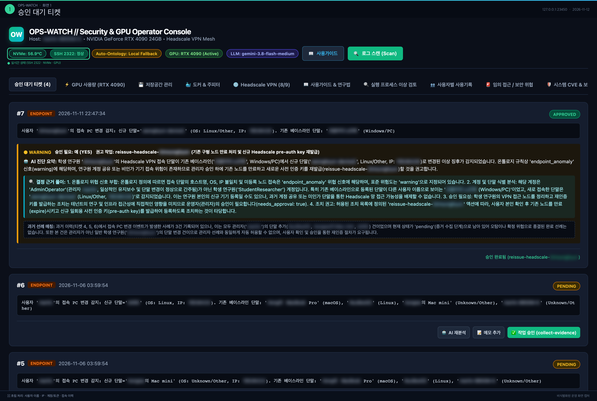
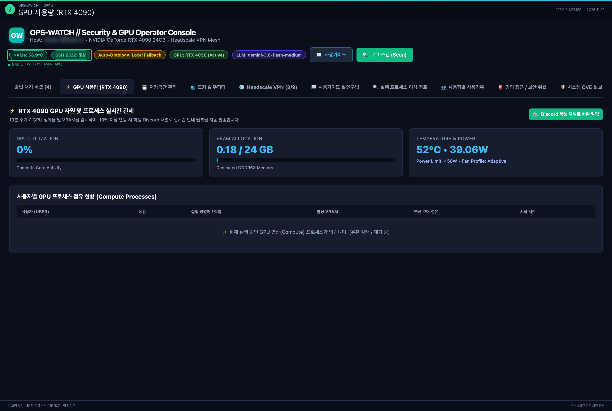
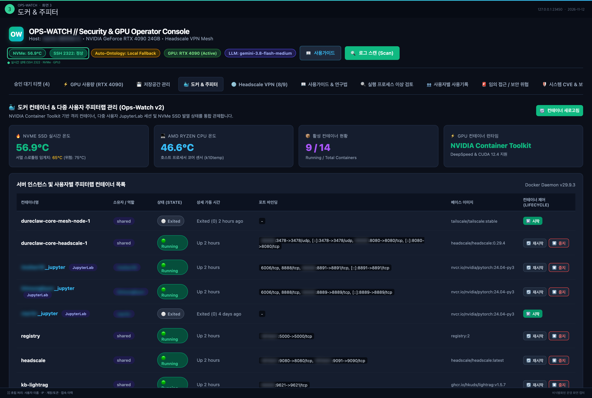
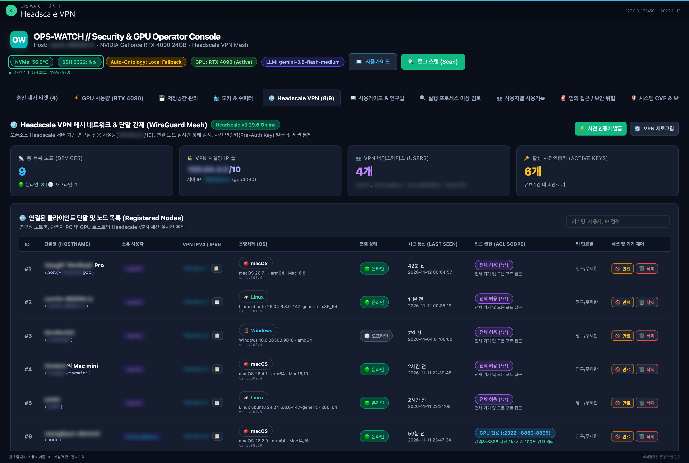
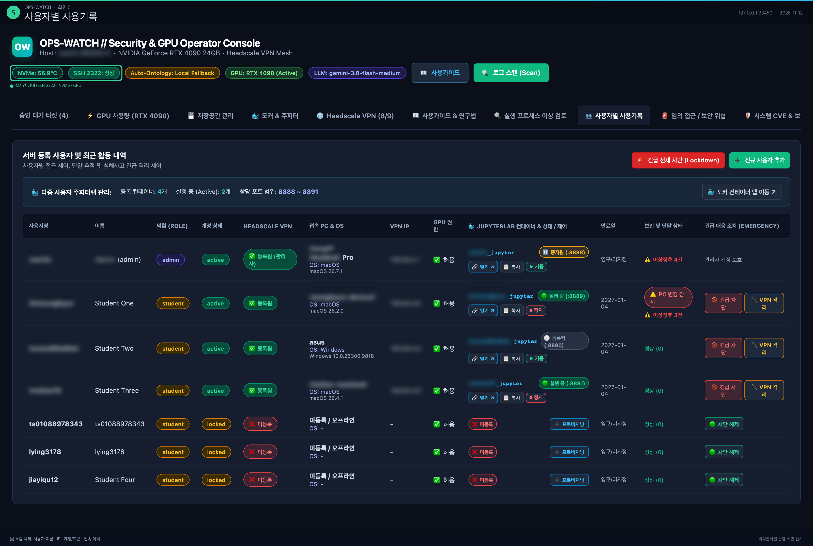
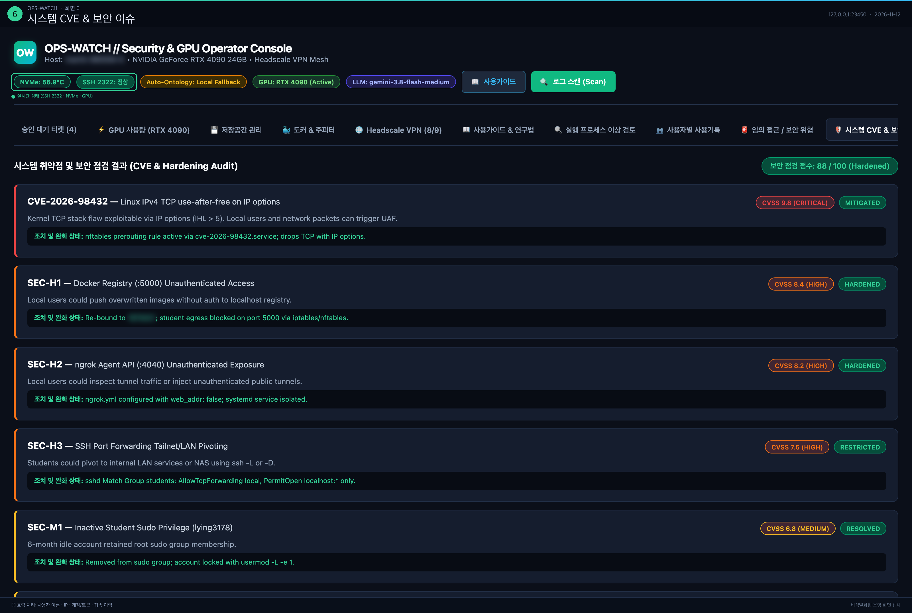
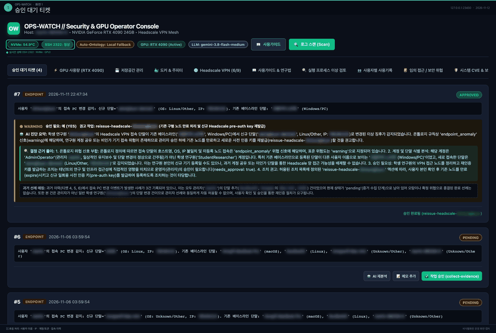
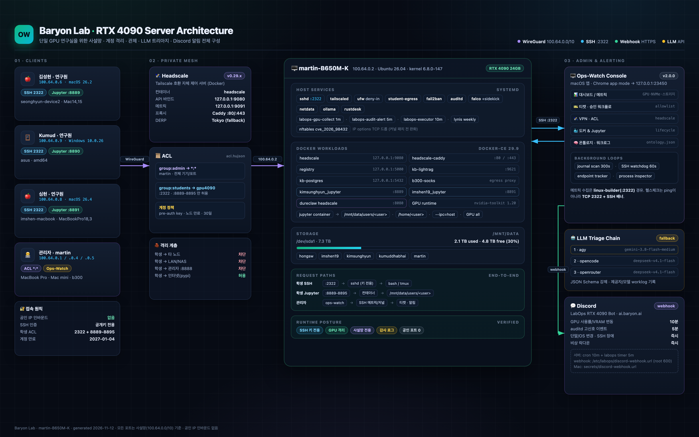

<p align="center">
  
</p>

<p align="center">
  <b>한 대의 RTX 4090을 여러 연구원이 안전하게 나눠 쓰기 위한 운영 · 보안 · 관제 스택</b><br>
  <sub>Private tailnet · per-user isolation · audit/Falco detection · self-hosted console · schema-constrained LLM triage · Discord alerting</sub>
</p>

<p align="center">
  
  
  
  
  
  
</p>

<p align="center">
  <a href="#-screenshots"><b>Screenshots</b></a> ·
  <a href="#-quick-start"><b>Quick Start</b></a> ·
  <a href="#-architecture"><b>Architecture</b></a> ·
  <a href="#-whats-inside"><b>Components</b></a> ·
  <a href="#-security-model"><b>Security</b></a> ·
  <a href="#-observability--alerting"><b>Observability</b></a> ·
  <a href="#-operations-runbook"><b>Runbook</b></a> ·
  <a href="docs/ARCHITECTURE.md"><b>Docs</b></a>
</p>

---

> **English** — An end-to-end operations stack for a single-GPU research workstation: a private Headscale/Tailscale mesh, per-user account lifecycle and isolation, egress firewalling, auditd/Falco detection, a self-hosted observability console, and schema-constrained LLM triage with provider fallback. Built and operated in production, published as a reproducible reference for small labs.

<details>
<summary><b>목차 · Table of contents</b></summary>

- [✨ Why this exists](#-why-this-exists)
- [📸 Screenshots](#-screenshots)
- [🧭 What's inside](#-whats-inside)
- [🚀 Quick start](#-quick-start)
- [🏗 Architecture](#-architecture)
- [🔐 Security model](#-security-model)
- [🩺 Observability & alerting](#-observability--alerting)
- [🧠 LLM triage](#-llm-triage)
- [🛠 Operations runbook](#-operations-runbook)
- [📓 Case study](#-case-study)
- [🗺 Roadmap](#-roadmap)
- [🤝 Contributing](#-contributing)
- [📄 License](#-license)

</details>

---

## ✨ Why this exists

Small labs don't fail because the GPU is slow — they fail because of **operations**. Who connected from which device? Who is using the GPU? Can a student reach the NAS? What evidence exists after an incident?

Most open-source stacks assume Kubernetes, SSO and an EDR team. A lab with **one GPU and five people** needs something smaller and stricter. This repository is that stack, running in production.

- **A complete, reproducible security baseline** — ACL, account expiry, egress blocking, audit logging, alerting and onboarding in one set.
- **Failure modes are documented, not hidden** — including a 17-hour SSH outage caused by an overlay container flushing the host's iptables chains. See [`docs/incidents/`](docs/incidents/).
- **LLM automation you can audit** — schema-enforced output, provider fallback, and a record of *which model* made each judgment.
- **Privacy-safe by default** — emails, keys and personal data live outside the code tree (`secrets/`, `private/`), with a pre-publication checklist.

## 📸 Screenshots

<p align="center">
  
</p>

| | | |
| :---: | :---: | :---: |
| <a href="docs/screenshots/01-tickets.png"></a><br><sub><b>Ticket triage</b> — AI 분석 · 승인 워크플로</sub> | <a href="docs/screenshots/02-gpu.png"></a><br><sub><b>GPU telemetry</b> — 사용률 · VRAM · 온도</sub> | <a href="docs/screenshots/03-containers.png"></a><br><sub><b>Containers</b> — 9/14 running · Jupyter 수명주기</sub> |
| <a href="docs/screenshots/04-vpn.png"></a><br><sub><b>VPN mesh</b> — Headscale 노드 · ACL</sub> | <a href="docs/screenshots/05-users.png"></a><br><sub><b>Users</b> — 계정 · GPU · Jupyter · 단말</sub> | <a href="docs/screenshots/06-cve.png"></a><br><sub><b>CVE & hardening</b> — 88/100 점검</sub> |

<p align="center">
  <br>
  <sub>6개 탭 워크스루 · 실제 운영 데이터 · 개인정보는 토큰 단위로 블러 처리</sub>
</p>

## 🧭 What's inside

| Area | What it does | Path |
|---|---|---|
| 🛰 **Private mesh** | Headscale control plane, Tailscale ACL, student key re-issue | [`headscale/`](headscale/) |
| 👥 **Account lifecycle** | User registry, `labctl sync`, expiry, sudo policy, privileged request queue | [`labops/`](labops/) |
| 📊 **Ops-Watch console** | macOS app · GPU/NVMe/storage metrics · tickets · VPN · containers | [`ops-watch/`](ops-watch/) |
| 🩺 **Reachability watchdog** | TCP 2322 + SSH banner (not `tailscale ping`) with state-transition alerts | [`ops-watch/health_check.py`](ops-watch/health_check.py) |
| 🧠 **LLM triage chain** | `agy → opencode → openrouter`, JSON-schema enforced, provider recorded | [`ops-watch/analysis_llm.py`](ops-watch/analysis_llm.py) |
| 🛡 **Hardening** | ufw + `student-egress`, sshd baseline, kernel CVE mitigation | [`scripts/hardening/`](scripts/hardening/) |
| 🧪 **GPU examples** | 4-bit inference, LoRA, video pipelines, Jupyter MCP client | [`examples/`](examples/) |
| 📚 **Docs** | Architecture, security audit, incident postmortems | [`docs/`](docs/) |

## 🚀 Quick start

```bash
git clone https://github.com/baryonlabs/linux-machine-4090.git
cd linux-machine-4090
```

**1 · Harden the server** (Ubuntu 24.04/26.04, run on the GPU host)

```bash
sudo bash scripts/hardening/harden.sh
sudo bash scripts/hardening/mitigate-cve-2026-98432.sh   # until the kernel fix is installed
```

**2 · Bring up the private mesh**

```bash
bash headscale/onboard-student.sh <username>
bash headscale/reissue-student-key.sh <username> --execute
```

**3 · Provision users and isolation**

```bash
sudo bash labops/install.sh
sudo labctl sync
sudo labctl status <username>
```

**4 · Run the console**

```bash
cd ops-watch
OPS_WATCH_PORT=23450 python3 dashboard.py
# → http://localhost:23450  (macOS app bundle: /Applications/Ops-Watch.app)
#   Binds 127.0.0.1 by default. This console can control the server, so expose it only
#   on a trusted host: OPS_WATCH_BIND=0.0.0.0
```

Verify the important part — the data plane:

```console
$ python3 ops-watch/health_check.py
SSH health: OK  (ok=True)
  checked : 2026-11-12 00:12:41
  since   : 2026-11-11 22:47:19
  last ok : 2026-11-12 00:12:41
  tailnet 100.64.0.2:2322: OPEN 14.8ms SSH-2.0-OpenSSH_9.6p1 Ubuntu-3ubuntu13.20
  tailscaled peer: online=True active=True os=linux
```

## 🏗 Architecture



<p align="center">
  <sub>원본 HTML: <a href="docs/architecture.html">docs/architecture.html</a> · 사용자 이름·IP·호스트명·계정명은 비식별화된 예시값입니다.</sub>
</p>

- **Access** — tailnet only, non-standard SSH `:2322`, public-key auth
- **Isolation** — students may reach `gpu4090:2322` and `:8889-8895` only; LAN, other nodes and admin services are blocked
- **Observability** — 5-minute journal scan, 60-second SSH reachability, GPU/NVMe/storage telemetry
- **Triage** — ontology-driven LLM analysis with a three-provider fallback chain

Full diagram and component notes: [`docs/ARCHITECTURE.md`](docs/ARCHITECTURE.md)

## 🔐 Security model

| Layer | Control |
|---|---|
| Network | Headscale ACL (admin `*:*`, students `gpu4090:2322` + `:8889-8895`), `ufw default deny`, `student-egress` blocks LAN / docker networks / admin ports |
| Accounts | key-only SSH, `AllowUsers`, account expiry (`chage -E`), minimal sudo, privileged requests via `labops` catalog |
| Runtime | auditd rules, Falco + falcosidekick, nftables CVE-2026-98432 mitigation |
| Detection | journal scan → tickets, endpoint/OS change tracking, process anomalies, SSH reachability |
| Secrets | `secrets/`, `private/`, `state/` excluded from the tree; webhook and keys kept out of Git |

> ⚠️ The defaults assume **a single admin and a trusted lab**. Do not expose this to the public internet; replace users, IPs and ACL groups before deploying elsewhere.

The latest repository + runtime review (history scan, console auth, port exposure) is documented in [`docs/security-review-2026-11-12.md`](docs/security-review-2026-11-12.md). The console now binds to loopback by default because it can start containers, issue VPN keys and add users.

## 🩺 Observability & alerting

**Ops-Watch** is a self-hosted console (macOS app + local web server) that collects metrics over SSH and keeps a ticket trail.

| Loop | Interval | What it does |
|---|---|---|
| Journal scan | 300 s | `journalctl -p warning..alert` → rule matching → tickets + worklog |
| SSH watchdog | 60 s | TCP `:2322` + SSH banner; alerts on `OK → FIREWALL_BLOCKED → OK` transitions |
| Endpoint tracker | per scan | real device info from Headscale `host_info` (OS version, distro, arch, model, client) |
| GPU notifier | 10 min | utilization/VRAM changes → Discord |
| LabOps audit alert | 5 min | high-signal auditd events → Discord |

```console
[auto-scan] 23:10:12 0 new ticket(s) (3.9s)
SSH 2322: 차단(방화벽)   ← what a real outage looks like in the header badge
```

## 🧠 LLM triage

Ticket analysis is **schema-constrained** and **provider-fallbacked**:

```console
$ python3 ops-watch/analysis_llm.py --self-test
OK   agy        gemini-3.8-flash-medium           19299ms  {'ok': True}
OK   opencode   opencode-go/deepseek-v4.1-flash    6300ms  {'ok': True}
OK   openrouter deepseek/deepseek-v4.1-flash       2404ms  {'ok': True}
```

- `agy` (Antigravity CLI, OAuth) → `opencode` → `openrouter` (HTTP, JSON mode)
- Each provider must return JSON matching the request schema; otherwise the next runs
- The winning provider/model is stored in the worklog (`llm:agy`, `llm:opencode,fallback`) and shown in the UI
- Timeouts kill the whole process group; hangs never block the chain

Configuration: `OPS_WATCH_LLM_CHAIN`, `OPS_WATCH_MODEL`, `OPS_WATCH_OPENCODE_MODEL`, `OPS_WATCH_OPENROUTER_MODEL`, `OPS_WATCH_LLM_TIMEOUT`.

## 🛠 Operations runbook

| Scenario | Command |
|---|---|
| New researcher | `sudo labctl sync` → issue pre-auth key → per-user Jupyter container |
| Suspected device / key leak | `headscale/reissue-student-key.sh <user> --execute` (expire node + new key) |
| Incident triage | Ops-Watch ticket → AI analysis → approve allowlisted action → worklog |
| SSH unreachable | verify `TCP 2322`, `iptables -S ts-input`, `ip addr show tailscale0` — **not** `tailscale ping` alone |
| Post-incident | record in [`docs/incidents/`](docs/incidents/) |

## 📓 Case study

**2026-11-11 — 17-hour SSH outage.** A DureClaw mesh E2E job ran on the production runner. Its second `tailscaled` instance shared the host's iptables chain names, flushed `ts-input`, and took `100.64.0.1` — the admin's tailnet address. `tailscale ping` stayed green the whole time because tailscaled answers it itself; only TCP died. The fix (stop the container), the root cause, and the monitoring gap that allowed it are documented in [`docs/incidents/2026-11-11-dureclaw-mesh.md`](docs/incidents/2026-11-11-dureclaw-mesh.md).

That incident produced `health_check.py` — which is why this repo checks the **data plane**, not the daemon.

## 🗺 Roadmap

- [x] Headscale ACL + account lifecycle
- [x] Hardening + kernel CVE mitigation
- [x] Ops-Watch console (metrics · tickets · VPN · containers)
- [x] TCP/SSH reachability watchdog
- [x] LLM triage with provider fallback
- [x] Real device inventory from Headscale `host_info`
- [ ] Ticket **reject/close** workflow (currently approve-only)
- [ ] Anonymized `users.yaml` template for forks
- [ ] Prometheus / Grafana export
- [ ] Multi-GPU scheduling

## 🤝 Contributing

Issues and PRs are welcome. Please read [`CONTRIBUTING.md`](CONTRIBUTING.md) and keep personal data out of commits. Security reports: see [`SECURITY.md`](SECURITY.md) (do not open a public issue).

## 📄 License

**TBD** — to be chosen before public release (Apache-2.0 or MIT recommended).

> **Maintainers:** before making this repository public, complete [`docs/open-source-checklist.md`](docs/open-source-checklist.md) (secrets, personal data, license, CI).

## ⭐ Star history

<!-- 공개 전환 후 활성화 (프라이빗에서는 이미지가 깨집니다)
<a href="https://star-history.com/#baryonlabs/linux-machine-4090&Date">
  
</a>
-->

> Repository is **private** for now. Star history and contributor widgets will be enabled when it goes public.

## 🙏 Acknowledgements

Built on the shoulders of [Headscale](https://github.com/juanfont/headscale), [Tailscale](https://tailscale.com), [Falco](https://falco.org), [auditd](https://github.com/linux-audit/audit-userspace) and [Docker](https://www.docker.com). Incident tooling inspired by real production pain.

---

<p align="center">
  <sub>Built and operated by <b>Baryon Labs</b> · martin-B650M-K · RTX 4090 24GB · Ubuntu 26.04 · updated 2026-11-12</sub>
</p>
