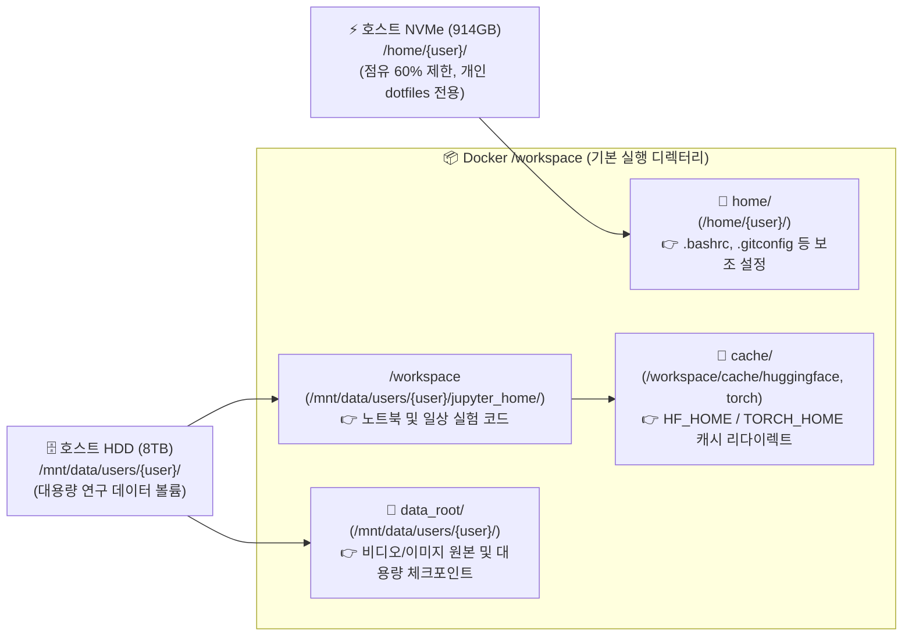
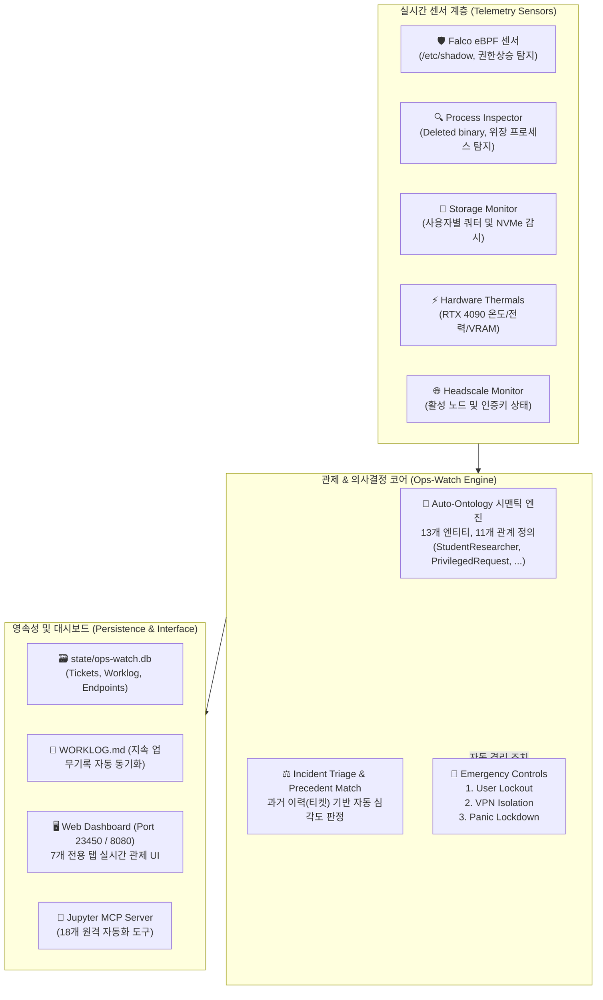

# 연구실 RTX 4090 워크스테이션 전체 시스템 아키텍처 명세서
**System Architecture Specification: martin-B650M-K Multi-Tenant AI Infrastructure**

> **버전**: v2.4.0  
> **최종 갱신일**: 2026-11-06  
> **호스트 시스템**: `martin-B650M-K` (AMD Ryzen + NVIDIA GeForce RTX 4090 24GB VRAM)  
> **운영 상태**: 프로덕션 운영 중 (멀티 테넌트 제로 트러스트 격리 및 자동 관제 연동)

---

## 1. 하이레벨 시스템 아키텍처 개요 (Overview)

연구실 워크스테이션은 **단일 고성능 GPU(RTX 4090 24GB)**와 **대용량 스토리지(8TB HDD + 1TB NVMe)**를 다수의 연구원(관리자 및 학생 연구원 3명)이 안전하고 공정하게 공유할 수 있도록 설계된 **제로 트러스트(Zero-Trust) 멀티 테넌트 AI 연구 인프라**입니다.

```mermaid
flowchart TD
    subgraph Clients["👤 사용자 및 단말 계층 (Client Layer)"]
        AdminDev["👑 관리자 (martin)<br/>MacBook / Mac mini / iPad / PC"]
        StudentKim["🎓 학생 1 (student1)<br/>Laptop (Web / SSH)"]
        StudentTwo["🎓 학생 2 (student2)<br/>Laptop (Web / SSH)"]
        StudentShen["🎓 학생 3 (student3)<br/>Laptop (Web / SSH)"]
    end

    subgraph NetworkSec["🛡️ 네트워크 & 보안 게이트웨이 (Zero-Trust VPN)"]
        NgrokTunnel["🌐 ngrok TLS Tunnel<br/>(<headscale-tunnel-host>)"]
        Headscale["🔐 Headscale (WireGuard Coordination)<br/>Virtual IP: 100.64.0.0/10"]
        ACL["📜 Headscale ACL (acl.hujson)<br/>- admin: *:* (Full Access)<br/>- students: gpu4090:2322, 8889-8895"]
    end

    subgraph HostSystem["🖥️ GPU 워크스테이션 (martin-B650M-K, 100.64.0.2)"]
        SSHGateway["🚪 SSH Gateway (Port 2322)<br/>비표준 포트 / fail2ban"]
        
        subgraph ComputeLayer["🐳 사용자별 독립 컨테이너 계층 (nvcr.io/nvidia/pytorch:24.04-py3)"]
            ContainerAdmin["📦 martin_jupyter<br/>Port: 8888<br/>Token: <TOKEN>"]
            ContainerKim["📦 student1_jupyter<br/>Port: 8889<br/>Token: <TOKEN>"]
            ContainerTwo["📦 student2_jupyter<br/>Port: 8890<br/>Token: <TOKEN>"]
            ContainerShen["📦 student3_jupyter<br/>Port: 8891<br/>Token: <TOKEN>"]
        end

        subgraph Hardware["⚡ 하드웨어 리소스"]
            RTX4090["🎮 NVIDIA RTX 4090 (24GB VRAM)<br/>CUDA 12.4 / Driver 550+"]
            SharedMemory["🧠 IPC Shared Memory (/dev/shm 15.2GB)"]
        end

        subgraph StorageLayer["💾 하이브리드 스토리지 계층"]
            NVMe["⚡ 914GB NVMe SSD (/): OS, Docker Root, 시스템 라이브러리"]
            HDD8TB["🗄️ 8TB HDD (/mnt/data): 연구 대용량 볼륨"]
            
            subgraph UserMounts["📁 사용자별 격리 마운트 (/mnt/data/users/{user})"]
                MountMartin["/workspace -> /mnt/data/users/martin/jupyter_home<br/>data_root/ -> /mnt/data/users/martin<br/>home/ -> /home/martin"]
                MountKim["/workspace -> /mnt/data/users/student1/jupyter_home<br/>data_root/ -> /mnt/data/users/student1"]
                MountTwo["/workspace -> /mnt/data/users/student2/jupyter_home<br/>data_root/ -> /mnt/data/users/student2"]
                MountShen["/workspace -> /mnt/data/users/student3/jupyter_home<br/>data_root/ -> /mnt/data/users/student3"]
            end
        end
    end

    subgraph Observability["📊 Ops-Watch & 지능형 관제 계층 (Port 23450 / 8080)"]
        Dashboard["🖥️ Ops-Watch Web Console"]
        AuditEngine["🛡️ Falco eBPF + Auditd (50-labops.rules)"]
        ProcInspect["🔍 process_inspector (Deleted Binary & 이상 탐지)"]
        StorageMon["📈 storage_monitor (8TB/NVMe 쿼터 추적)"]
        ZombieDetect["⏱️ ZombieKernelDetector (GPU 자원 자동 회수)"]
        OntologyBridge["🧠 Auto-Ontology 시맨틱 엔진 (ontology.json)"]
        DurableDB["💾 state/ops-watch.db (SQLite) + WORKLOG.md"]
        JupyterMCP["🤖 Jupyter MCP Server (AI Agent 인터페이스)"]
    end

    Clients -->|WireGuard Encrypted| NgrokTunnel
    NgrokTunnel --> Headscale
    Headscale --> ACL
    ACL -->|Full Route| HostSystem
    ACL -->|Port 2322, 8889-8895 Only| ComputeLayer

    ComputeLayer --> RTX4090
    ComputeLayer --> SharedMemory
    ComputeLayer --> UserMounts
    UserMounts --> HDD8TB
    
    HostSystem -.->|Telemetry & Logs| Observability
    Observability -.->|통제 & 조치 (Lockout / Restart)| HostSystem
    JupyterMCP -.->|MCP Tools (18개)| ContainerAdmin
```

---

## 2. 계층별 상세 아키텍처 명세

### 1) 제로 트러스트 네트워크 & 인가 계층 (Zero-Trust Network & ACL)
* **Tailscale / Headscale 오버레이 네트워크**:
  * 공인 IP 및 포트포워딩을 완전히 배제하고, WireGuard 기반 가상 사설망(`100.64.0.0/10`)을 구성합니다.
  * 외부 접속 중계는 ngrok 보안 터널(`https://<headscale-tunnel-host>`)을 통해 이루어집니다.
* **접근 제어 정책 (`acl.hujson`)**:
  * **`group:admin` (`martin`)**: 모든 호스트 및 모든 포트(`*:*`) 양방향 무제한 접근 허용.
  * **`group:students` (`student1`, `student2`, `student3`)**:
    * 허용: `gpu4090:2322` (SSH), `gpu4090:8889-8895` (개인별 JupyterLab 포트)
    * 차단: 관리자 JupyterLab(`8888`), 관리자 로컬 단말(Mac, iPad), 타 학생 장비 간 직접 통신은 **패킷 레벨에서 Drop**되어 네트워크 탐색 자체가 불가능합니다.

---

### 2) 멀티 테넌트 컨테이너 격리 및 포트 매핑 (Compute Isolation)
모든 연구원은 호스트 OS에 직접 프로세스를 띄우지 않고, 공식 NVIDIA PyTorch 런타임이 격리된 Docker 컨테이너 내에서만 연구를 수행합니다.

| 사용자 계정 | 역할 | JupyterLab 포트 | 보안 토큰 (Token) | 기본 시작 디렉터리 (`/workspace`) | 컨테이너 이름 |
| :--- | :--- | :---: | :--- | :--- | :--- |
| **`martin`** | 관리자 | `8888` | `<TOKEN>` | `/mnt/data/users/martin/jupyter_home` | `martin_jupyter` |
| **`student1`** | 학생 연구원 | `8889` | `<TOKEN>` | `/mnt/data/users/student1/jupyter_home` | `student1_jupyter` |
| **`student2`**| 학생 연구원 | `8890` | `<TOKEN>` | `/mnt/data/users/student2/jupyter_home` | `student2_jupyter` |
| **`student3`** | 학생 연구원 | `8891` | `<TOKEN>` | `/mnt/data/users/student3/jupyter_home` | `student3_jupyter` |

* **컨테이너 이미지**: `nvcr.io/nvidia/pytorch:24.04-py3` (PyTorch 2.3, CUDA 12.4, cuDNN 9 탑재)
* **공유 메모리**: PyTorch `DataLoader` 다중 워커 통신 병목을 없애기 위해 `/dev/shm` 16GB를 컨테이너에 직접 매핑.

---

### 3) 하이브리드 스토리지 아키텍처 (Storage Architecture)
연구실 서버의 고질적인 문제인 **"HuggingFace/Torch 모델 다운로드로 인한 OS 디스크(NVMe) 용량 고갈"**을 완벽히 방지하도록 3중 마운트 구조를 적용했습니다.



* **필수 캐시 환경변수 (노트북 첫 셀 자동 적용)**:
  ```python
  import os
  os.environ["HF_HOME"] = "/workspace/cache/huggingface"
  os.environ["TORCH_HOME"] = "/workspace/cache/torch"
  ```

---

### 4) 자원 공유 거버넌스 및 GPU 에티켓 (GPU Resource Governance)
* **단일 GPU (24GB VRAM) 공유 원칙**:
  * 브라우저 창만 닫아도 VRAM은 반납되지 않으므로, 실험 종료 시 반드시 상단 메뉴 **`Kernel -> Shut Down All Kernels`** 실행 의무화.
* **좀비 커널 감지 및 자동 회수 (`ZombieKernelDetector`)**:
  * 프로세스가 VRAM을 4GB 이상 점유한 상태에서 GPU 연산률이 30분 이상 0%인 경우 `ops-watch`가 비활성 커널로 판정하여 알림 발송 및 강제 자원 회수 가능.

---

### 5) Ops-Watch & 지능형 관제 시스템 (Observability & Security)



* **지속적 운영 기록 (Durable Worklog)**:
  * 모든 관리자 조치, 사용자 온보딩, VPN 키 발급, 패키지 이상 분석 내역이 `ops-watch.db`와 `WORKLOG.md`에 실시간 기록/동기화됩니다.
* **AI 에이전트 연동 (Jupyter MCP Server)**:
  * 로컬 AI 에이전트가 `run_jupyter_mcp.py`를 통해 서버 내 주피터 환경(커널 실행, 코드 인젝션, 파일 탐색)을 18개 도구로 직접 원격 제어할 수 있는 M2M(Machine-to-Machine) 인터페이스 구축 완료.

---

## 3. 핵심 포트 및 경로 요약 레퍼런스

| 구분 | 주소 / 포트 | 용도 및 설명 |
| :--- | :--- | :--- |
| **Headscale Coordination** | `https://<headscale-tunnel-host>` | 외부 접속용 Tailscale 중계 URL |
| **GPU 서버 VPN IP** | `100.64.0.2` (`gpu4090`) | 사설망 내 워크스테이션 고정 주소 |
| **SSH Gateway** | `100.64.0.2:2322` | 비표준 SSH 포트 (보안 접속) |
| **관리자 JupyterLab** | `100.64.0.2:8888` | martin 전용 고권한 주피터랩 |
| **학생 JupyterLab** | `100.64.0.2:8889 ~ 8891` | student1, student2, student3 |
| **Ops-Watch 관제 콘솔** | `http://localhost:23450` (호스트 `8080`) | 관제 웹 대시보드 및 REST API |
| **스토리지 (OS NVMe)** | `/` (914GB) | Docker 엔진 및 시스템 전용 (보호 대상) |
| **스토리지 (연구 데이터)** | `/mnt/data/` (8TB) | 사용자 데이터, 비디오 데이터셋, 가중치 캐시 |
